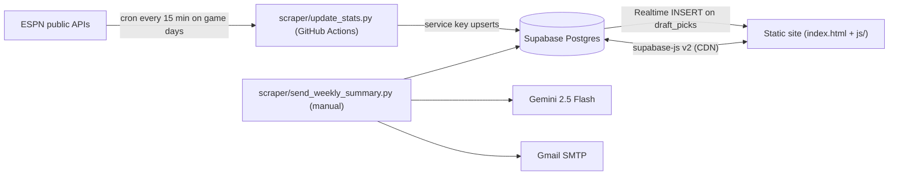

# Architecture Reference

How the Worst QB site fits together. For a quick orientation, read [`AGENTS.md`](../AGENTS.md) first.

---

## 1. Frontend

### Boot sequence
1. `index.html` loads Google Fonts, `css/style.css`, the supabase-js v2 UMD bundle from jsDelivr (sets `window.supabase`), then `js/app.js` as an ES module.
2. `js/supabase.js` creates the client from the hard-coded URL and key, and exports `supabase` (or `null` if the CDN script failed).
3. `js/app.js` imports every view, builds the `routes` map, creates the `Router`, calls `router.handleHashChange()`, and wires up the auth modal (login / sign-up with an `email_opt_in` user-metadata flag) and the Login/Logout button.

### Router (`js/router.js`)
- Parses `#/<route>?<query>` into `(routeName, params)`. Empty hash → `rules`.
- Shows `#league-nav` when `params.league` is set, rewrites its links to keep `?league=`, and lazily fetches the league name.
- Sets `.active` on the global nav links, then runs `appContent.innerHTML = view.render(params)` followed by `view.init(params)`.
- Clicks on any element with a `data-route` attribute are turned into hash navigation (legacy support; no current markup uses it).
- Unknown routes do nothing: the previous view stays on screen.

### Routes / views

| Hash route | File | Purpose | Key tables |
|---|---|---|---|
| `rules` (default) | `views/rules.js` | Static rules and scoring table | – |
| `dashboard` | `views/dashboard.js` | "My Leagues": the user's memberships, with stored `season_points` | `league_members` + `leagues` |
| `leagues` | `views/leagues.js` | List all leagues, create a league (prompt/confirm dialogs), join with a team name. **No nav link points here.** | `leagues`, `league_members` |
| `league_detail?league=` (also accepts `?id=`) | `views/league_detail.js` | League Home. Tabs: Season Standings, Weekly Performance, Team Performance. Recomputes all points client-side with the league's `scoring_settings`. Admin modal edits scoring weights and the per-week draft order (drag and drop). | `leagues`, `league_members`, `draft_picks`, `player_stats` |
| `draft?league=` | `views/draft.js` | Draft room: QB and "Other Positions" tabs, search, min-attempts filter, sorting, turn enforcement, Realtime sync, admin Force Draft / Auto-Pick / Undo, player profile modal | `leagues`, `league_members`, `draft_picks`, `players`, `player_projections` |
| `projections[?league=]` | `views/projections.js` | Projections table (week and position filters, search, min attempts, win probability). Shows the scraper's `projected_custom_points`; does **not** apply league scoring even with `?league=`. | `player_projections` + `players` |
| `stats[?league=]` | `views/stats.js` | Season-to-date leaderboard (Individual QBs / Top Weekly / Team QBs), excluding preseason. Shows the scraper's `custom_points`; ignores league scoring. | `player_stats` + `players` |
| `player_profile?id=[&league=]` | `views/player_profile.js` | Bio, game log (preseason rows tinted purple, regular-season totals) and the 2026 projections table. **Does** apply league scoring when `league` is passed. Also embedded in the draft-room modal. | `players`, `player_stats`, `player_projections`, `leagues` |
| `settings` | `views/settings.js` | Email opt-in toggle (`auth.updateUser({ data: { email_opt_in } })`). Nav link only shows when logged in. | Supabase Auth |
| `matchups` | inline in `app.js` | Placeholder ("Live stats feed will appear here") | – |

### Admin detection is inconsistent
- `league_detail.js` treats a user as admin if `league_members.is_admin = true`.
- `draft.js` treats a user as admin if `leagues.created_by === currentUserId`.

A co-admin who isn't the creator can edit settings but can't Force Draft, Undo or Auto-Pick.

### Draft room logic (`views/draft.js`)
- `currentWeek = min(leagues.current_week, 18)`.
- Members are sorted by `season_points` ascending (the stored column), then re-sorted by `scoring_settings.draft_order_overrides[currentWeek]` if one exists.
- `getDraftState()`: if every member has at least 1 pick, the target is 2, otherwise 1. The first member in order with fewer picks than the target is on the clock. So the order is linear, with round 2 using the same order as round 1.
- Pool filters: drafted players are removed. The QB tab keeps `position.includes('QB')`. The OTHER tab keeps non-QB, non-DST positions. `TM_QB` is hidden for `scoring_type === 'individual'` leagues.
- Note: team-QB leagues still show individual QBs in the QB tab; nothing restricts them to `TM_QB` only.
- Auto-Pick takes the highest projected QB (not `TM_QB`) with at least 10 projected attempts.
- Realtime: subscribes to `postgres_changes` INSERT on `public.draft_picks`, filters by league client-side, then refetches picks. DELETE events (undo) aren't subscribed, so other clients won't see an undo until they refresh.
- `init` calls `supabase.removeAllChannels()` before subscribing, and appends a new `<style>` tag to `<head>` on every visit (they pile up).

---

## 2. Database (Supabase)

Base schema: `schema.sql`. Later changes are separate files that were run by hand. There's no migration tool and no record of which files have been applied. Rough apply order, inferred from the content:

1. `schema.sql`: base tables and RLS
2. `schema_scoring_type.sql`: `leagues.scoring_type`, `player_stats.attempts/completions` (no `IF NOT EXISTS`; errors if re-run)
3. `schema_admin_scoring.sql`: `league_members.is_admin`, `leagues.scoring_settings`
4. `schema_expansion.sql`: player bio columns
5. `schema_projections.sql`: `player_projections` table and very permissive RLS
6. `schema_draft_overrides.sql`: `leagues.draft_order_overrides` column (**unused**: the code stores overrides in `scoring_settings.draft_order_overrides`)
7. `schema_preseason.sql`: `player_stats.season_type` and the new unique key

### Tables

**`leagues`**: `id uuid`, `name`, `created_by → auth.users`, `created_at`, `current_week int (default 1)`, `draft_status ('pending'|'active'|'completed')`, `scoring_type ('individual'|'team_qb')`, `scoring_settings jsonb`, `draft_order_overrides jsonb (unused)`

`scoring_settings` keys (defaults): `pass_yds -0.05`, `pass_tds -5`, `ints 3`, `pick_sixes 5`, `rush_yds -0.1`, `rush_tds -5`, `fumbles_lost 3`, `sacks 1`, `team_loss 5`, `no_attempts -20`, `completion_penalty_multiplier 20`, plus `draft_order_overrides: { "<week>": [user_id, ...] }`.

**`league_members`**: `league_id`, `user_id`, `team_name`, `season_points numeric` (stored; never updated by the app), `draft_position` (unused), `is_admin`. Unique on `(league_id, user_id)`.

**`players`**: `id text` (`espn-<id>` or `TEAM_<ABBR>_<season_type>`), `name`, `team` (abbreviation), `position` (slash-joined slots / `TM_QB` / `Unknown`), `status`, `headshot_url`, `height`, `weight`, `college`, `age`.

**`draft_picks`**: `league_id`, `user_id`, `player_id`, `week`, `pick_number (1|2)`. Unique on `(league_id, user_id, week, pick_number)` and `(league_id, player_id, week)`. No `season_type`, so picks always mean regular-season weeks.

**`player_stats`**: one row per `(player_id, week, season_type)`. Columns: passing_yards, passing_tds, interceptions, pick_sixes, rushing_yards, rushing_tds, fumbles_lost, sacks, attempts, completions, completion_percentage, team_loss, custom_points, last_updated.

**`player_projections`**: one row per `(player_id, week)`. Columns: `projected_custom_points`, `opponent` (a **JSON string**: `{"opp": "<ABBR>", "raw": {attempts, completions, passing_yards, passing_tds, interceptions, pick_sixes, rushing_yards, rushing_tds, fumbles_lost, sacks, team_loss_prob, team_loss}}`).

### RLS (as declared in the repo)
- SELECT for `authenticated` on the base tables.
- INSERT own row on `league_members` and `draft_picks`.
- `player_projections`: `FOR ALL USING (true)`, so anyone, including anon, can write.
- No UPDATE/DELETE policies are declared for `leagues` or `draft_picks`. Admin settings saves and pick undos only work because the browser uses the service_role key (see KNOWN_ISSUES #1). The live project may have extra policies added in the dashboard that aren't in this repo.

---

## 3. Scraper (`scraper/update_stats.py`)

Run with `python scraper/update_stats.py [--year 2026]`. Needs `SUPABASE_URL` and `SUPABASE_SERVICE_KEY`.

GitHub Actions (`.github/workflows/live_stats.yml`) runs it every 15 minutes on these UTC windows: Sun 17:00–23:45 (Sunday afternoon ET), and 00:00–04:45 on Sun/Mon/Tue/Fri (Sat/Sun/Mon/Thu night games ET). It can also be run manually via `workflow_dispatch`. Nothing runs during the week outside those windows. The secrets `SUPABASE_URL` and `SUPABASE_SERVICE_KEY` must be set in the repo.

Each run does a **full re-scrape** of the season, not just the current week:

1. **Actuals**: `fetch_actuals_gamecast(year, week, season_type)` for preseason weeks 1–4 (`seasontype=1`) and regular weeks 1–18 (`seasontype=2`).
   - Scoreboard: `https://site.api.espn.com/apis/site/v2/sports/football/nfl/scoreboard?dates={year}&seasontype={st}&week={w}`
   - Per game: `https://site.api.espn.com/apis/site/v2/sports/football/nfl/summary?event={id}`. Parses the boxscore `passing` / `rushing` / `fumbles` stat groups by their `keys` (e.g. `completions/passingAttempts`, `sacks-sackYardsLost`).
   - Pick sixes: from play-by-play drives, scoring plays containing both `INTERCEPTED` and `TOUCHDOWN`. Regex pulls `X.Lastname pass`, then fuzzy-matches the initial and last name to the boxscore display name.
   - Team loss: from `header.competitions[0].competitors[].winner`.
   - Rows with `attempts == 0 and rushing_yards == 0 and fumbles_lost == 0` are skipped.
   - Players are upserted with `position: 'Unknown'` (projections fix this up later in the same run).
2. **Team QB aggregation** builds `TEAM_<ABBR>_<season_type>` rows. It's currently a no-op because of a bug (KNOWN_ISSUES #4).
3. **Upserts**: players, then `player_stats` in chunks of 500 with `on_conflict='player_id,week,season_type'`.
4. **Projections**: `scrape_espn_projections(year, current_week=1)`.
   - `fetch_schedules_and_odds(year)`: scoreboard weeks 1–18. Builds `(teamId, week) → {opponent, loss_prob}` from the closing moneyline, with implied probabilities normalized to remove the vig.
   - ESPN Fantasy API: `https://lm-api-reads.fantasy.espn.com/apis/v3/games/ffl/seasons/{year}/segments/0/leaguedefaults/3?view=kona_player_info` with an `X-Fantasy-Filter` header asking for up to 3000 players sorted by % owned.
   - Projection stat entries: `statSourceId == 1 && statSplitTypeId == 1`, `scoringPeriodId` = week.
   - ESPN stat IDs used: `0` attempts, `1` completions, `3` pass yds, `4` pass TD, `20` INT, `24` rush yds, `25` rush TD, `72` fumbles lost, `99` D/ST sacks.
   - A QB's projected sacks = the opponent D/ST's projected sacks that week.
   - Player matching uses `fuzzy_match_player` against existing `espn-%` IDs (exact normalized name, then last name + first initial). Unmatched players are inserted with `espn-<id>`.
   - Upserts players (position/team refreshed) and `player_projections` (`on_conflict='player_id,week'`).

### ESPN ID maps (in `update_stats.py`)
- `ESPN_TEAM_MAP`: proTeamId → abbreviation (note `33: BAL`, `34: HOU`, `0: FA`).
- `ESPN_POS_MAP`: defaultPositionId → position (1 QB, 2 RB, 3 WR, 4 TE, 5 K, 16 DST).
- `ESPN_SLOT_MAP`: eligibleSlot → label (0 QB, 2 RB, 4 WR, 6 TE, 17 K, 16 DST). OP/FLEX were deliberately removed.

---

## 4. Weekly email (`scraper/send_weekly_summary.py`)

Run by hand: `python scraper/send_weekly_summary.py`. There is no workflow for it. It loads `.env`.

For each league:
1. Reads `current_week`, members (ordered by stored `season_points`), that week's picks, and that week's `player_stats`.
2. Weekly points = the sum of the scraper's `custom_points` for each member's picks. It does **not** use the league's `scoring_settings`, so the numbers can differ from League Home.
3. Asks `gemini-2.5-flash` for a snarky 3–4 paragraph HTML recap.
4. Emails all opted-in members in **one message with every address in the `To:` header** (recipients can see each other's addresses). Sent via Gmail SMTP with an app password.
5. Recipients come from `auth.admin.list_users()`. `email_opt_in` defaults to true.
6. The footer settings link is hard-coded to `http://localhost:5500/#/settings`.

---

## 5. Utility scripts (`scripts/`)

- `generate_mock_data.py`: creates 6 auth users (`mock_<rand>_<n>@worstqb.com` / `password123`), an individual league and a team_qb league at week 18, random picks for weeks 1–18, and sets stored `season_points`. **Writes to the production project.**
- `import_historical.py`: dry run only. Fuzzy-matches the `qb_name` column of a historical-picks CSV against `players`. League creation and pick insertion are left as TODOs.
